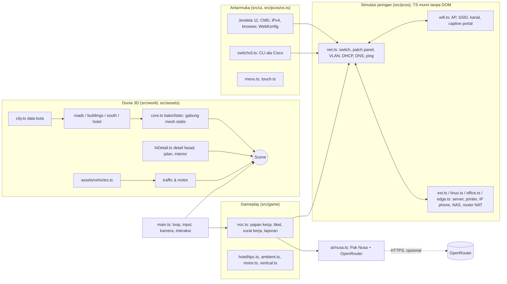

# Arsitektur Kota Nusantara

Game simulasi TKJ berbasis web (Three.js + TypeScript + Vite). Semua grafis dibuat prosedural di kode: tidak ada file model, tekstur, atau font dari luar. Hasil build bisa berupa satu file HTML yang jalan offline.

## Gambaran besar



## Modul

| Folder | Isi | Catatan |
|---|---|---|
| `src/data/city.ts` | Jalan, persil, gedung, lantai hotel, nama objek sesuai brief (ROAD_, ZONE_, BLD_, PROP_, ANCHOR_) | Satu sumber kebenaran untuk tata kota |
| `src/data/sites.ts` | Fase 1: Kantor Nusa Teknik, rumah, kos, warnet (posisi gedung, PC, AP, tangga kos, subnet) | Dibaca oleh `world/sites.ts`, `pcos/net.ts`, `pcos/wifi.ts`, `pcos/sites.ts`, `main.ts` |
| `src/world/` | Pembangun dunia: jalan, gedung, hotel 8 lantai, Kota Selatan, siang-malam, detail tambahan (`hiDetail.ts`) | Mesh statis digabung per material oleh `core.ts` supaya draw call rendah |
| `src/assets/` | Kendaraan, perangkat jaringan, orang (skinning di shader) | Geometri dibuat sekali per varian lalu dipakai bersama |
| `src/pcos/net.ts` | Simulasi jaringan berkabel: outlet → patch panel → port switch, VLAN, trunk, loop, DHCP, DNS, ping, routing | Murni TypeScript, diuji di `tests/net.test.ts` |
| `src/pcos/` lainnya | Wi-Fi, server Linux, perangkat kantor, router edge, OS PC tiruan, CLI switch, terminal | Semua yang dilihat pemain (ipconfig, ping, nslookup) dihitung dari state simulasi, bukan naskah |
| `src/game/noc.ts` | Pekerjaan: surat kerja (kontrak) dan tiket shift, injeksi gangguan nyata, verifikasi, laporan kerja, XP/pangkat | Pekerjaan hanya selesai kalau jaringan benar-benar sehat **dan** sudah diuji dari perangkatnya |
| `src/game/field/` | Fase 1 karier lapangan: templat order (`templates.ts`), uang & reputasi (`economy.ts`), papan order/garansi/hari kerja (`orders.ts`), save `kotaNusantara.field.v1` (`save.ts`), gangguan di simulator (`sim.ts`), kontroler UI (`field.ts`) | Logika murni diuji di `tests/field.test.ts`; memakai ulang modal, meja crimp, rak/console, tahap kerja dan cek berita acara (`noc/berita.ts`) dari magang |
| `src/ai/nusa.ts` | Pak Nusa: mentor AI, keluhan pelanggan AI, umpan balik catatan tiket, mesin offline | Lihat bagian AI |
| `src/ui/` | Menu utama, pengaturan, kontrol sentuh, peta | DOM biasa, font sistem |
| `src/main.ts` | Loop game, input, kamera, interaksi, penghubung semua modul | Hook QA di `window.__kota` |

## Alur satu tiket

1. `noc.startShift()` memilih PC dan gangguan (bobot lebih tinggi untuk materi yang sering gagal), lalu `inject()` benar-benar merusak state di `net.ts` (kabel dicabut, port di-shutdown, DNS salah, VLAN salah, dan lain-lain).
2. Keluhan ditulis ulang dengan gaya pelapor: versi offline langsung, versi AI menggantikan bila tersedia.
3. Pemain bekerja secara fisik: jalan ke lokasi, ambil alat, cek kabel, console ke switch, konfigurasi di PC.
4. `noc.check()` tiap 0,4 detik membaca state simulasi. Tiket ditutup hanya jika `healthy()` benar dan pemain sudah menguji (ping/buka situs) dari PC itu.
5. Laporan kerja: bintang (SLA, dampak ke perangkat lain, kerapian), log tindakan otomatis, dan catatan penutupan tiket dengan umpan balik Pak Nusa.

## AI (Pak Nusa)

- **Mentor** (`J` atau tombol Pak Nusa): konteks yang dikirim = pekerjaan aktif, langkah berikutnya menurut sistem, log tindakan, status adapter simulasi di dekat pemain, dan penyebab asli yang ditandai RAHASIA. Prompt sistem melarang memberi jawaban langsung dan mengarahkan diagnosis urut lapisan OSI.
- **Keluhan pelanggan**: satu panggilan per shift, JSON terstruktur, hanya berdasarkan gejala, tidak boleh menebak penyebab.
- **Umpan balik catatan tiket**: cek offline 4 bagian (gejala, penyebab, tindakan, verifikasi) selalu jalan; AI menambah ulasan dibanding fakta tiket.
- **Fallback**: tanpa key, offline, error HTTP, atau timeout 20 detik, semua fitur memakai mesin offline. Game tidak pernah bergantung pada AI.
- **Transparansi**: setiap teks AI diberi label `AI`, mode AI/offline terlihat di panel, bertanya ke Pak Nusa dihitung seperti memakai petunjuk.

## Privasi dan Green IT

- Tidak ada akun, analitik, iklan, atau cookie pelacak. Progres (`kotaNusantara.noc.v1`), catatan (`kotaNusantara.notes.v1`), pengaturan, dan API key hanya di `localStorage` perangkat pemain.
- Yang dikirim ke OpenRouter hanya data simulasi dan teks yang diketik pemain. API key tidak pernah masuk build atau repo.
- Efisiensi: mesh statis digabung (bakeStatic), instancing untuk pohon dan detail, culling per lantai hotel dan jarak, satu file HTML tanpa unduhan tambahan. Bila FPS di bawah 24, game mematikan AO lalu menurunkan resolusi render; aset tidak diganti.

## Menjalankan

```bash
npm ci
npm run dev          # localhost:5173
npm test             # unit test (vitest)
npx tsc --noEmit     # cek tipe
npx vite build       # build ke dist/
```

Versi satu file ada di `single/index.html` (bisa dibuka langsung tanpa server). Untuk AI, isi API key OpenRouter di Pengaturan → Pak Nusa.

## Pengujian

- `tests/`: unit test simulasi jaringan (kabel terstruktur, VLAN, trunk, loop, DHCP, gateway, DNS) dan Pak Nusa (mesin offline, klien AI dengan jaringan tiruan).
- `tools/qa/`: skrip Playwright yang memainkan game dengan input keyboard/mouse sungguhan (kabel, tiket, Wi-Fi, server Linux, router edge, NPC, AI dengan OpenRouter tiruan).
- CI GitHub Actions menjalankan cek tipe, unit test, dan build pada setiap push.
